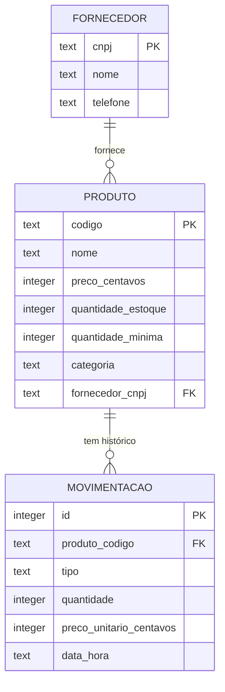

# Sistema de Estoque (Java)

Sistema de gerenciamento de estoque para uma loja, feito em Java com interface de console. Os dados ficam guardados em um banco SQLite, acessado com JDBC puro (sem framework). O foco do projeto é a **modelagem orientada a objetos**, a **separação em camadas** e a **persistência em banco de dados**.

## Funcionalidades

- Cadastro de fornecedores e produtos (com categoria e fornecedor vinculados)
- Entrada de estoque (compra) e saída de estoque (venda), com atualização automática da quantidade
- Bloqueio de venda quando não há estoque suficiente
- Alerta de estoque baixo (quantidade menor ou igual ao mínimo definido por produto)
- Listagem de produtos por categoria e por fornecedor
- Relatórios: valor total em estoque, produtos mais vendidos e histórico de movimentações
- Dados gravados em arquivo: continuam lá quando o programa é fechado
- Opção para carregar dados de exemplo e testar rapidamente

## Tecnologias

- Java 21
- Maven
- SQLite com JDBC (`java.sql`, driver `sqlite-jdbc`)
- JUnit 5

## Arquitetura

```
src/main/java/com/vitor/estoque
├── Main.java                      # menu de console (só lê e exibe dados)
├── model/                         # entidades e regras próprias de cada objeto
│   ├── Produto, Fornecedor, MovimentacaoEstoque
│   └── Categoria, TipoMovimentacao (enums)
├── repository/
│   ├── Repositorio<T, ID>         # interface (contrato)
│   ├── RepositorioEmMemoria       # implementação sem banco (modo --memoria e testes)
│   ├── GerenciadorDeTransacao     # "tudo ou nada" para operações com várias gravações
│   └── jdbc/                      # implementação com banco de dados
│       ├── BancoDeDados           # conexão, criação das tabelas e transações
│       └── Produto/Fornecedor/MovimentacaoRepositorioJdbc
├── service/
│   └── EstoqueService             # regras de negócio e relatórios
└── exception/                     # exceções de negócio customizadas
src/main/resources/schema.sql      # tabelas, restrições e índices
```

O `EstoqueService` só conhece as interfaces `Repositorio` e `GerenciadorDeTransacao`. Por isso ele funciona igual com os dados em memória ou no banco, e os mesmos cenários de teste rodam nos dois.

## Banco de dados



O arquivo `estoque.db` é criado na pasta onde o programa roda. As tabelas são criadas automaticamente a partir do `schema.sql`.

### Decisões de projeto

- **Encapsulamento de verdade:** `Produto` valida seus próprios dados (preço não negativo e com no máximo 2 casas decimais, não vende mais do que existe), então nenhum código externo consegue deixá-lo em estado inválido.
- **Interface de repositório:** trocar a persistência em memória pelo banco não exigiu mexer nas regras de negócio, só criar as classes `jdbc`.
- **Transações:** entrada e saída de estoque fazem duas gravações (o produto e o histórico). Elas acontecem dentro de uma transação, então se uma falhar a outra é desfeita e o estoque nunca fica diferente do histórico.
- **`PreparedStatement` em todas as consultas:** os valores nunca são concatenados no SQL, o que evita SQL injection. Há um teste gravando um nome como `Robert'); DROP TABLE produto;--`.
- **Dinheiro em centavos inteiros no banco:** o SQLite não tem tipo decimal exato. No programa continua `BigDecimal`, convertido na ida e na volta.
- **Regras também no banco:** `CHECK`, chaves estrangeiras e `PRIMARY KEY` impedem dados inválidos mesmo se alguém alterar o arquivo por fora (as chaves estrangeiras exigem `PRAGMA foreign_keys = ON`, feito ao abrir a conexão).
- **Histórico imutável:** cada `MovimentacaoEstoque` guarda o preço unitário da época. Por isso um produto que já teve entrada ou saída não pode ser removido.
- **Ids das movimentações** são gerados pelo programa. Ao abrir um banco com histórico, a contagem continua do último id gravado. Isso pressupõe um único programa usando o arquivo por vez.
- **Os relatórios são calculados em Java** a partir das listas lidas do banco. Com muitos registros, o ideal seria `GROUP BY` e `SUM` direto no SQL.

## Como executar

Pré-requisito: JDK 21 ou superior.

**Pelo IntelliJ IDEA:** abra a pasta do projeto (File > Open > selecione o `pom.xml`), aguarde o Maven baixar as dependências e execute a classe `Main`. O arquivo `estoque.db` aparece na pasta do projeto.

**Pelo terminal (com Maven instalado):**

```bash
mvn clean package
java -jar target/sistema-estoque-1.0-SNAPSHOT.jar
```

Na primeira execução, use a opção **11** do menu para carregar dados de exemplo. Para rodar sem gravar nada, use `java -jar target/sistema-estoque-1.0-SNAPSHOT.jar --memoria`. Para começar do zero, apague o arquivo `estoque.db`.

## Testes

```bash
mvn test
```

Os testes cobrem as regras de `Produto` e `MovimentacaoEstoque`, o `EstoqueService` em memória, cada repositório JDBC isolado e o service rodando sobre o banco: persistência entre execuções, desfazer a operação quando algo falha no meio, bloqueio de remoção de produto com histórico e proteção contra SQL injection.
